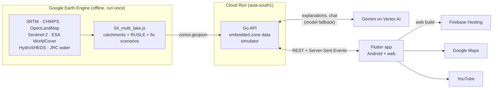

# JalRakshak

**Find where soil washes into Aravalli lakes, and plan the cheapest works that keep it on the land.**

Every monsoon, rain strips topsoil from the Aravalli hills and fields of southern Rajasthan and carries it into the lakes downstream. The lakes silt up and hold less water, and farmers lose their most fertile soil. Gram panchayats and watershed committees can fund simple soil-saving works under MGNREGA, but they rarely know *where* to build them or *how much* each one would help.

JalRakshak answers both questions from satellite data. It splits each lake's catchment into zones, estimates how many tonnes of soil each zone loses every year, and lets a panchayat build a restoration plan zone by zone, with the soil saved recalculated live. Gemini explains each zone in plain Hindi or English: why it erodes, which fix to start with, and how to fund it.

Built for the GDG Udaipur Aravalli Build Championship.

**Live:** web app at https://jal-rakshak-75ce7.web.app · API at `https://jalrakshak-api-870269078343.asia-south1.run.app/api/lakes`

## Features

- **Five lakes, one map.** Jaisamand, Rajsamand, Jawai, Badi and Siliserh, each split into catchment zones coloured by soil loss (t/ha/yr).
- **Restoration planner.** Toggle contour bunds, contour trenches and revegetation per zone, or use quick plans ("4 worst zones", "all hill land"). Totals update instantly, and the progress bar stays pinned while you scroll.
- **Gemini explanations.** For any zone: a headline, the reasons it erodes (tied to its numbers), recommended fixes with the tonnes each saves, and a tip for farmers. Saved on the device after the first load, so they work offline.
- **Ask follow-up questions.** Streaming chat about a zone ("Can this be done under MGNREGA?"), answered from that zone's data, formatted with headings and bullet points.
- **Video guides.** YouTube tutorials for the fixes that apply to the zone, in the app's language.
- **PDF report.** One tap exports the plan: summary, a map of the zones coloured by soil loss after the plan, a zone-by-zone table and Gemini's explanations of the worst zones. Hindi text is shaped correctly.
- **Hindi and English** throughout, including Gemini's answers. Light and dark themes, responsive from phone to desktop.

## Architecture



1. **Science, offline.** Earth Engine scripts trace each lake's catchment from elevation data, split it into zones and run the RUSLE soil-erosion model (A = R × K × LS × C × P). They also precompute every zone's soil loss for each fix, split by land type: bunds lower P on cropland, while trenches lower P and revegetation lowers C on scrub and bare hill land. The output is one GeoJSON file.
2. **API.** A small Go service embeds that GeoJSON, so it needs no database. Simulating a plan is plain arithmetic over the precomputed scenarios, which makes it instant. For explanations and chat it sends Gemini the zone's facts, already rounded and formatted, so the model only puts numbers into words and never calculates them. Explanations are cached per zone and language, and pre-generated answers are embedded as a fallback for when Gemini is down. When a model is out of quota or overloaded, the next one in the list takes over.
3. **App.** A Flutter app for Android and web, organised by feature. It draws zones on Google Maps, runs the planner against the API, streams chat over Server-Sent Events, and builds PDF reports on the device.

## Tech stack

| Layer | Technology |
|---|---|
| Geospatial analysis | Google Earth Engine (JavaScript): SRTM DEM, CHIRPS rainfall, OpenLandMap soil, Sentinel-2 NDVI, ESA WorldCover, HydroSHEDS, JRC Global Surface Water |
| Erosion model | RUSLE, with per-land-type scenarios for contour bunds, contour trenches and revegetation |
| Backend | Go 1.25 (standard library `net/http`), `google.golang.org/genai` |
| AI | Gemini 3.1 Flash-Lite, with 3.5 Flash and 3 Flash as fallbacks, via Vertex AI; structured JSON output for explanations, streaming for chat |
| Hosting | Cloud Run (distroless container, built by Cloud Build), Firebase Hosting for the web app |
| App | Flutter 3.47 / Dart 3.13, Riverpod 3, go_router, Dio, Material 3 Expressive |
| Maps | Google Maps (`google_maps_flutter`, Maps JavaScript API on web) |
| Reports | `pdf` + `printing`, with Hindi text shaped by Flutter's text engine |
| Other | `flutter_markdown_plus` (chat formatting), `url_launcher` (videos), `shared_preferences` (offline cache), ARB localisation (English, Hindi) |

## Repository layout

```
01_catchment.js … 04_multi_lake.js   Earth Engine scripts (04 produces the data the app uses)
backend/                             Go API (see backend/README.md)
  cmd/api/                           entry point: config, wiring, -pregen
  data/                              embedded zones.geojson and lakes.json
  internal/catchment/                lakes, zones, simulator
  internal/gemini/                   explanations, chat, prompts, model fallback
  internal/api/                      HTTP routes, handlers, middleware
  internal/config/                   .env and environment settings
app/                                 Flutter app
  lib/core/                          theme, router, network, l10n, shared widgets
  lib/features/                      lakes, catchment (map), simulator (plan),
                                     insights (Gemini + videos), report (PDF), settings
```

## Run it locally

**Backend** (Go 1.25+). Put `GEMINI_API_KEY=<key from aistudio.google.com>` in `backend/.env`, then:

```powershell
cd backend
go run ./cmd/api          # http://localhost:8080/api/lakes
go test ./...
```

**App** (Flutter 3.47+). Copy `app/.env.example` to `app/.env`, set `API_URL` (`http://localhost:8080` for a local backend) and `MAPS_API_KEY`, then:

```powershell
cd app
flutter run --dart-define-from-file=.env          # add -d chrome for web
```

On a USB-connected Android phone with a local backend, run `adb reverse tcp:8080 tcp:8080` first so `localhost` reaches your computer.

## Deploy

- **API:** `gcloud run deploy` from `backend/`. The full command, Vertex AI setup and secrets are in [backend/README.md](backend/README.md).
- **Web:** `flutter build web --release --dart-define-from-file=.env`, then `firebase deploy --only hosting` from `app/`.
- **Android:** `flutter build apk --release --dart-define-from-file=.env`. It is signed with the debug key for now, so set up a release key before publishing to the Play Store.

## Limitations

- Soil loss values are model estimates for comparing places, not field measurements. RUSLE leaves out gully erosion, so losses in ravine zones are likely higher than shown.
- Zones for newer lakes come from approximate outlet points, so check them against local knowledge before acting.
- Gemini can make mistakes. The app tells users to confirm plans with the block office before spending money.
